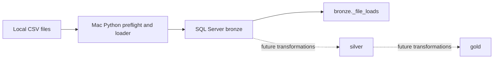

# ai_medallion_wh

## Goal and current stage

This repository starts a SQL Server medallion warehouse using a deterministic Python process on macOS to read local CSV files and insert their raw text into a bronze layer. Stage 1 implements the project scaffold, local CSV preflight, setup scripts, medallion schemas, a file-load ledger, and append-only bronze ingestion. Silver and gold transformations, orchestration, and production operations are future work. The loader does not call an AI model at runtime.

## Architecture



The loader uses `pyodbc` and the installed Microsoft ODBC Driver 18, validates each CSV's field counts, stores source fields as `nvarchar(max)`, records source path/load timestamp/load ID, and hashes inputs. Successful unchanged files are skipped. Changed files are intended to be recorded as new loads without replacing earlier bronze rows.

## Requirements

- Apple Silicon Mac with Docker Desktop and the existing running `sqlserver2025` SQL Server container, published on `localhost:1433`.
- Python 3, Homebrew (for process-local OpenSSL discovery), and an already working ODBC Driver 18 setup.
- DBeaver for optional interactive database access.

The scripts never install or reconfigure ODBC. They do not use `BULK INSERT` or Docker Compose. Secrets are not stored in this repository; `.env` is ignored and `.env.example` contains placeholders only.

## Setup and run

```bash
scripts/setup.sh
scripts/load.sh --preflight
scripts/load.sh --setup-only
```

The preflight command is offline: it lists files, sizes, SHA-256 hashes, encodings, headers, row counts, and proposed tables. `--setup-only` verifies the ODBC connection and SQL Server version, then creates the project database, schemas, and ledger without loading CSVs. The normal command repeats preflight and loads files transactionally after the human review checkpoint described below. Run it from a visible Mac Terminal if the container does not expose a usable `MSSQL_SA_PASSWORD`; the password prompt is hidden. A failed driver/SQL connection stops before database changes.

## Database and DBeaver

Database: `ai_medallion_wh`; schemas: `bronze`, `silver`, `gold`. DBeaver connection details: SQL Server; host `localhost`; port `1433`; database `ai_medallion_wh`; user `sa`; password supplied locally; encryption disabled (`Encrypt=no`) and trust server certificate enabled. DBeaver has not been configured automatically.

## CSV source and mappings

The local CSV inputs were copied from the supplied `source_erp/` and `source_crm/` folders. Their redistribution terms were not established; CSVs remain local and Git-ignored. This project makes no source-license or attribution claim. Obtain authorized replacements from the party that supplied the files. Place inputs beneath `datasets/`; nested folders are supported and become part of the bronze table name.

| Relative path | Proposed table |
|---|---|
| `source_crm/cust_info.csv` | `bronze.source_crm_cust_info` |
| `source_crm/prd_info.csv` | `bronze.source_crm_prd_info` |
| `source_crm/sales_details.csv` | `bronze.source_crm_sales_details` |
| `source_erp/CUST_AZ12.csv` | `bronze.source_erp_cust_az12` |
| `source_erp/LOC_A101.csv` | `bronze.source_erp_loc_a101` |
| `source_erp/PX_CAT_G1V2.csv` | `bronze.source_erp_px_cat_g1v2` |

The loader preserves valid header names. Empty, duplicated, reserved, invalid, or metadata-colliding names receive deterministic safe names, which are displayed by preflight before loading.

## Designing the user–agent workflow

The project requirements were prompt-defined; this conversation did not include an iterative design discussion. The initial goal was to create Stage 1 of a SQL Server medallion warehouse from scratch on a Mac, with an explicit local loader, safe credential handling, Git/GitHub choices, and a human checkpoint before data load.

| User input or decision | Agent action | Human checkpoint |
|---|---|---|
| Project name `ai_medallion_wh`, SQL Server/T-SQL, DBeaver, and existing container `sqlserver2025` | Scaffold targets that database and reuse-only container workflow | Review connection information; configure DBeaver manually |
| Source folder paths for ERP and CRM | Copy six CSVs unchanged into nested `datasets/` folders; ignore local data in Git | Review preflight and proposed mappings before any load |
| Mac-side Python loader and ODBC Driver 18 | Implement `pyodbc` scripts and process-local OpenSSL handling | Run from visible Terminal only if hidden password input is unavailable |
| Support nested/multiple CSVs and preserve bronze history | Derive table names, hash files, validate fields, and use a load ledger | One review checkpoint covers all files |
| Public GitHub repository | Keep datasets excluded pending redistribution permission; prepare local Git | GitHub authentication and repository/push status are to be reported after checks |

The intended human review checkpoint is after scaffold, setup, and complete preflight but before bronze table creation or CSV loading. No troubleshooting outcome or approval is claimed here.

## Implemented and future work

Implemented: scaffold, local dataset exclusion, preflight and table mapping, database/schema/ledger setup code, and raw bronze loader mechanics. Future: silver and gold transformations, data quality rules beyond structural CSV checks, scheduling, and production monitoring.
