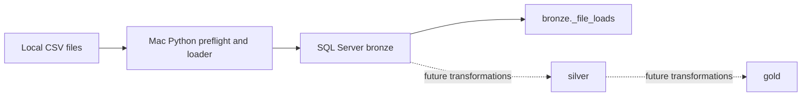

# ai_medallion_wh

## Goal and current stage

This repository starts a SQL Server medallion warehouse using a deterministic Python process on macOS to read local CSV files and insert their raw text into a bronze layer. Stage 1 implements the project scaffold, local CSV preflight, setup scripts, medallion schemas, a file-load ledger, and append-only bronze ingestion. Silver and gold transformations, orchestration, and production operations are future work. The loader does not call an AI model at runtime.

## Architecture



The loader uses `pyodbc` and the installed Microsoft ODBC Driver 18, validates each CSV's field counts, stores source fields as `nvarchar(max)`, records source path/load timestamp/load ID, and hashes inputs. Successful unchanged files are skipped. Changed files are intended to be recorded as new loads without replacing earlier bronze rows.

## Requirements

- Apple Silicon Mac with Docker Desktop and the existing running `sqlserver2025` SQL Server container, published on `localhost:1433`.
- Python 3, Homebrew (for process-local OpenSSL discovery), and an already working ODBC Driver 18 setup.
- DBeaver for optional interactive database access.

The scripts never install or reconfigure ODBC. They do not use `BULK INSERT` or Docker Compose. Secrets are not stored in this repository; `.env` is ignored and `.env.example` contains placeholders only.

## Setup and run

```bash
scripts/setup.sh
scripts/load.sh --preflight
scripts/load.sh --setup-only
```

The preflight command is offline: it lists files, sizes, SHA-256 hashes, encodings, headers, row counts, and proposed tables. `--setup-only` verifies the ODBC connection and SQL Server version, then creates the project database, schemas, and ledger without loading CSVs. The normal command repeats preflight and loads files transactionally after the human review checkpoint described below. Run it from a visible Mac Terminal if the container does not expose a usable `MSSQL_SA_PASSWORD`; the password prompt is hidden. A failed driver/SQL connection stops before database changes.

## Database and DBeaver

Database: `ai_medallion_wh`; schemas: `bronze`, `silver`, `gold`. DBeaver connection details: SQL Server; host `localhost`; port `1433`; database `ai_medallion_wh`; user `sa`; password supplied locally; encryption disabled (`Encrypt=no`) and trust server certificate enabled. DBeaver has not been configured automatically.

## CSV source and mappings

The local CSV inputs were copied from the supplied `source_erp/` and `source_crm/` folders. Their redistribution terms were not established; CSVs remain local and Git-ignored. This project makes no source-license or attribution claim. Obtain authorized replacements from the party that supplied the files. Place inputs beneath `datasets/`; nested folders are supported and become part of the bronze table name.

| Relative path | Proposed table |
|---|---|
| `source_crm/cust_info.csv` | `bronze.source_crm_cust_info` |
| `source_crm/prd_info.csv` | `bronze.source_crm_prd_info` |
| `source_crm/sales_details.csv` | `bronze.source_crm_sales_details` |
| `source_erp/CUST_AZ12.csv` | `bronze.source_erp_cust_az12` |
| `source_erp/LOC_A101.csv` | `bronze.source_erp_loc_a101` |
| `source_erp/PX_CAT_G1V2.csv` | `bronze.source_erp_px_cat_g1v2` |

The loader preserves valid header names. Empty, duplicated, reserved, invalid, or metadata-colliding names receive deterministic safe names, which are displayed by preflight before loading.

## Designing the user–agent workflow

The reusable project prompt was developed iteratively in the separate **Explore AI workflow automation** conversation. The build conversation then supplied the finalized, project-specific requirements; design iteration happened while shaping the prompt, before this project was created.

The starting idea was broader than this Stage 1: explore how a Mac-based AI agent could turn a plan into a medallion warehouse workflow—from obtaining data and creating project/database structures through bronze validation, user-directed silver transformations, gold facts and dimensions, and generated architecture or star-schema diagrams. The discussion narrowed that into a repeatable project prompt with explicit inputs, bounded actions, and human review points. Stage 1 implements the setup and bronze foundation; the later transformations and diagram generation remain future workflow ideas.

Earlier project attempts exposed practical handoff problems. The prompt was refined so a CSV attachment itself signals continuation without a separate “done” message, and so credential handling uses the existing container environment or a hidden prompt in a visible Mac Terminal. GitHub troubleshooting also showed that Codex’s restricted shell could report a saved keychain login as invalid; the prompt therefore calls for an elevated/local authentication check before asking the user to sign in again. These lessons informed the workflow requirements used here.

| User input or decision | Agent action | Human checkpoint |
|---|---|---|
| Started with a broad plan to delegate warehouse setup and later modeling to an AI agent; refined it into a reusable staged workflow | Prompt defines project inputs, setup/loader actions, validation, future-stage boundaries, and review points | User supplies project-specific choices; agent pauses before the first data load |
| Earlier attempts revealed confusing CSV handoffs and password prompts | Prompt treats an attachment as the continuation signal and confines password entry to a visible Terminal when needed | User attaches files or enters credentials locally; never needs to paste a password into chat |
| Earlier GitHub checks sometimes failed inside a restricted shell despite a valid Mac keychain login | Prompt calls for an elevated/local check and a single recovery path if authentication is genuinely invalid | User signs in only if that check reports a real authentication failure |
| Project name `ai_medallion_wh`, SQL Server/T-SQL, DBeaver, and existing container `sqlserver2025` | Scaffold targets that database and reuse-only container workflow | Review connection information; configure DBeaver manually |
| Source folder paths for ERP and CRM | Copy six CSVs unchanged into nested `datasets/` folders; ignore local data in Git | Review preflight and proposed mappings before any load |
| Mac-side Python loader, ODBC Driver 18, nested CSV support, and bronze history preservation | Implement `pyodbc` scripts, process-local OpenSSL handling, deterministic mappings, hashes, and the load ledger | One review checkpoint covers all files; later silver/gold business choices remain user-directed |
| Public GitHub repository | Exclude local datasets because redistribution permission was not established; commit and push the scaffold | GitHub status is checked before publishing; DBeaver remains a manual user setup |

The human review checkpoint for this build was after scaffold, database/schema setup, and complete preflight, before bronze tables and CSV data were created. The user later ran the loader; a cursor handling error was fixed, after which all six files loaded and validated. The loader is deterministic and does not call an AI model at runtime. The agent carried out prompt-bounded setup and ingestion; the user defined the workflow, supplied project inputs and datasets, and controlled the data-load handoff.

## Implemented and future work

Implemented: scaffold, local dataset exclusion, preflight and table mapping, database/schema/ledger setup code, and raw bronze loader mechanics. Future: silver and gold transformations, data quality rules beyond structural CSV checks, scheduling, and production monitoring.
